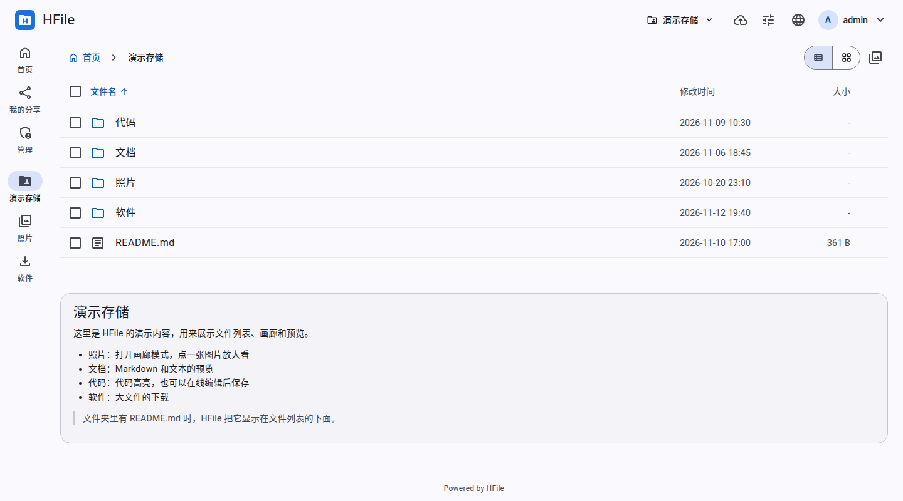
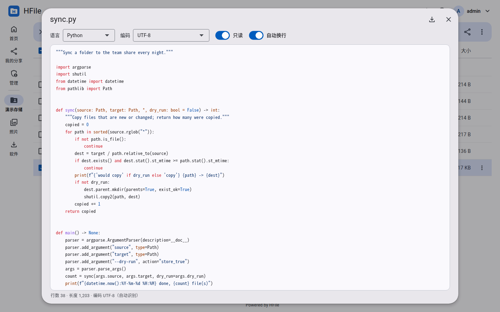
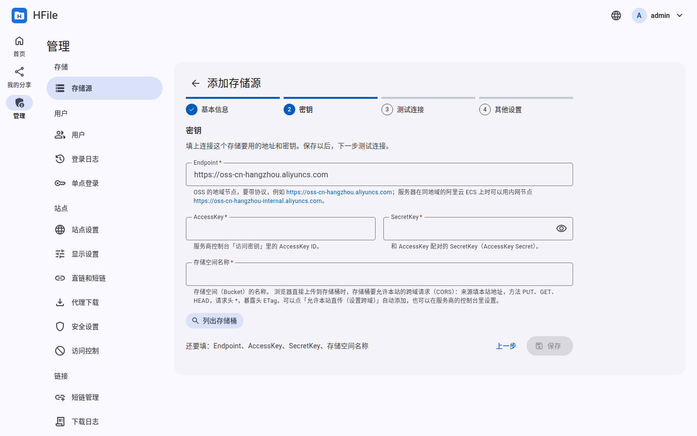
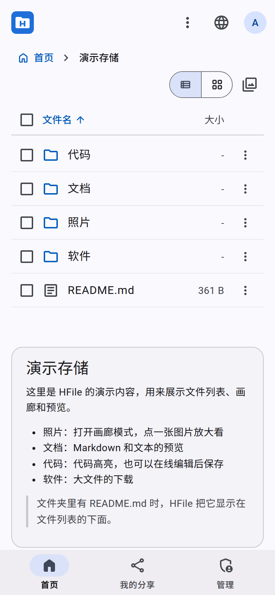

<div align="center">


# HFILE

[](config/version.py)
[](https://www.python.org/)
[](https://www.djangoproject.com/)
[](LICENSE)

</div>

简体中文 | [English](docs/README.en.md)

自己部署的在线文件列表程序：把本地文件夹、FTP/SFTP、WebDAV、SMB、对象存储、网盘和自建的服务挂到一个网站上，浏览、预览、上传和分享。

[功能特性](#功能特性) · [截图](#截图) · [快速开始](#快速开始) · [部署](#部署) · [配置](#配置) · [文档](#文档) · [参与开发](#参与开发) · [常见问题](#常见问题) · [许可证](#许可证)



## 简介

HFile 把分散在各处的存储挂到同一个网站上。在浏览器里就能浏览文件夹，在线看图片、视频和文档，上传下载，生成直链和分享。管理员可以给每个用户在每个存储源上设定根目录和权限。

HFile 用 Django 写成：

- **部署简单**：一个单文件程序就能运行，自带 Web 服务器和安装向导，服务器上不用装 Python。
- **界面**：页面按 Material Design 3 做，有浅色和深色主题，手机上也能用。有简体中文和英文，按浏览器的语言显示，也可以在顶栏切换。前端不用构建，也不依赖 CDN。
- **数据库**：SQLite（默认）或 MySQL 8.4+。启动时自动升级数据库，升级前先备份，失败自动恢复。

## 功能特性

- **48 种存储源**：
  - 本地文件夹；
  - FTP（支持 FTPS）、SFTP、WebDAV、SMB（Windows 共享、NAS）；
  - 对象存储：S3 兼容存储、MinIO、阿里云 OSS、腾讯云 COS、华为云 OBS、七牛云、多吉云、又拍云、Azure Blob 存储、Bunny Storage；
  - 网盘：OneDrive 和 SharePoint（都有世纪互联版，OneDrive 还能用应用身份访问组织里的每个人的网盘）、Google Drive、115 网盘、阿里云盘、百度网盘、123云盘（这三个都通过开放平台）、Yandex Disk、Dropbox、GitHub 仓库、FebBox；
  - 自建服务：OpenList / AList、Seafile、可道云（KodBox）、Cloudreve（v3、v4）、Teldrive、Misskey、CloudFlare ImgBed、IPFS、Emby / Jellyfin；
  - 只读的分享链接和发布页：GitHub Releases、CNB Releases、网页服务器的目录列表、URL 树、123云盘直链、OpenList 分享、联想 NAS 分享、OneDrive 分享链接。
  - 新建存储源有四步向导，网盘在网页上授权或扫码登录。
- **文件管理**：列表、图标、画廊三种视图；新建文件夹、重命名、移动、复制、删除；右键菜单、多选和键盘操作。
- **存储源之间复制**：管理员在管理页建复制任务，把一个存储源的文件夹复制到另一个存储源，边读边写，不存到服务器的硬盘上；可以设线程数、总限速、遇到同名文件跳过还是覆盖、失败重试几次，看得到每个文件的进度和速度，详细日志按时间记下每个文件复制、跳过、重试和失败，随时可以停止，失败或停止的任务可以接着复制。
- **上传**：
  - 可以拖进文件或整个文件夹；
  - 大文件分块上传，网络断了从断的那一块接着传；
  - 对象存储、OneDrive 和 Dropbox 可以由浏览器直传，不经过本站；
  - 遇到同名文件时问覆盖还是跳过。
- **在线预览**：
  - 图片；视频（含 m3u8 和字幕）；音频（有播放列表）；
  - 文本和代码，可以在线编辑后保存；
  - Markdown、PDF；
  - 接入 OnlyOffice（可以多人同时编辑）和 kkFileView。
- **直链、短链和分享**：
  - 直链和短链带下载频率限制、Referer 防盗链和下载日志；
  - 分享可以设访问密码和有效期，能看到什么跟着分享者的权限走。
- **权限**：每个用户在每个存储源上有自己的根目录和 15 种权限。另有过滤规则（隐藏、不可访问、不可下载）、目录密码和目录文档。
- **账号和安全**：图片验证码、超级管理员的两步验证（TOTP）、登录安全入口、单点登录（GitHub、Gitee、GitLab、OpenID Connect）、IP 和 UA 黑名单。
- **运维**：安装向导、数据库备份和恢复命令、自动清理过期的会话和上传、诊断信息页；访问记录里的口令和签名自动打码；操作日志：登录、文件的改动、短链和分享、管理员的每次修改，只增不改；IP 归属地：用户、操作日志和下载日志里的 IP 显示国家或地区，用城市数据库时很多还有省和城市，数据库是 MaxMind 的 GeoLite2-City 或 GeoLite2-Country（二选一），在本机查询。

每个功能的详细说明见[功能说明](docs/features.md)。

## 截图

<table>
  <tr>
    <td width="50%"><p align="center">画廊模式（深色主题）</p></td>
    <td width="50%"><p align="center">代码预览，可以在线编辑</p></td>
  </tr>
  <tr>
    <td valign="top"><p align="center">添加存储源的向导</p></td>
    <td valign="top" align="center"><p align="center">手机上</p></td>
  </tr>
</table>

截图里的文件是演示用的，图片是程序生成的。

## 技术栈

| 部分 | 用的是 |
|---|---|
| 后端 | Python 3.12、Django 6.1、Django REST Framework 3.18 |
| Web 服务器 | waitress（纯 Python，打包在程序里）；静态文件由 WhiteNoise 提供 |
| 前端 | Django 模板加原生 JavaScript，按 Material Design 3 做 |
| 预览 | hls.js、pdf.js、highlight.js（随仓库提供，不走 CDN） |
| 数据库 | SQLite 或 MySQL 8.4+ |
| 打包 | PyInstaller（单文件程序） |

## 快速开始

### 环境要求

- 系统：Linux、Windows 或 macOS。Linux 的单文件程序要 glibc 2.34 以上（Ubuntu 22.04、Debian 12、Rocky/RHEL 9 或更新）；Windows 的 x86-64 版只在 Windows Server 2025 上试过，arm64 版和 macOS 的（Apple 芯片、Intel 各一个）每次发布前在 GitHub 的 Windows 11、macOS 15 上跑全部测试和打包检查，没有在真的电脑上试过（见[「在 Windows 上运行」](docs/deploy.md#在-windows-上运行)、[「在 macOS 上运行」](docs/deploy.md#在-macos-上运行)）。
- 从源码运行或打包：要有 conda（比如 Miniforge），用它建的环境是 Python 3.12。Intel 的 Mac 和 Windows arm64 上有几步不一样，见[开发](docs/development.md#本地运行)。
- 数据库：SQLite 不用另装；也可以用 MySQL 8.4 以上（不支持 MariaDB 和 PostgreSQL）。

### 下载程序

[Releases](https://github.com/hualuoo/hfile/releases) 里有打包好的单文件程序，Linux、Windows、macOS 的 x86-64 和 arm64 各一个，不用装 Python。下面的命令按 `uname -m` 下载这台机器用的那个：

```bash
mkdir -p ~/hfile && cd ~/hfile
curl -fLO https://github.com/hualuoo/hfile/releases/latest/download/hfile-linux-$(uname -m)
curl -fLO https://github.com/hualuoo/hfile/releases/latest/download/SHA256SUMS
sha256sum --check --ignore-missing SHA256SUMS   # 核对下载的程序
mv hfile-linux-$(uname -m) hfile
chmod +x hfile
./hfile                                         # 设置文件、SQLite 数据库和上传的文件都放在程序旁边
```

macOS 上一样，下载的是 `hfile-macos-…`，用 `shasum` 核对（用浏览器下载的见[「在 macOS 上运行」](docs/deploy.md#在-macos-上运行)）：

```bash
mkdir -p ~/hfile && cd ~/hfile
curl -fLO https://github.com/hualuoo/hfile/releases/latest/download/hfile-macos-$(uname -m)
curl -fLO https://github.com/hualuoo/hfile/releases/latest/download/SHA256SUMS
shasum -a 256 --check --ignore-missing SHA256SUMS   # 核对下载的程序
mv hfile-macos-$(uname -m) hfile
chmod +x hfile
./hfile                                             # 和 Linux 上一样，文件都放在程序旁边
```

Windows 上在 PowerShell 里，按 `$env:PROCESSOR_ARCHITECTURE`（`AMD64` 或 `ARM64`）下载这台机器用的那个：

```powershell
mkdir $HOME\hfile; cd $HOME\hfile
$name = if ($env:PROCESSOR_ARCHITECTURE -eq "ARM64") { "hfile-windows-arm64.exe" } else { "hfile-windows-x86_64.exe" }
curl.exe -fLO https://github.com/hualuoo/hfile/releases/latest/download/$name
curl.exe -fLO https://github.com/hualuoo/hfile/releases/latest/download/SHA256SUMS
(Get-FileHash $name).Hash -eq (Select-String " $name$" SHA256SUMS).Line.Split(" ")[0]   # True：核对下载的程序
Rename-Item $name hfile.exe
.\hfile.exe                                      # 和 Linux 上一样，文件都放在程序旁边
```

### 从源码运行

```bash
git clone https://github.com/hualuoo/hfile.git
cd hfile
conda env create -f environment.yml
conda activate hfile
pip install -r requirements.lock       # 间接依赖也换成测试过的版本
python -B hfile.py
```

### 打包成单文件程序

```bash
conda activate hfile
scripts/build.sh                     # 生成 dist/hfile，打包的是最后一次提交
mkdir -p ~/hfile && cp dist/hfile ~/hfile/
~/hfile/hfile                        # 设置文件、SQLite 数据库和上传的文件都放在程序旁边
```

打包还要有 binutils（PyInstaller 要用其中的 `objdump`；Debian、Ubuntu 上是 `sudo apt install binutils`）。Windows 上在 Git for Windows 的 bash 里运行 `scripts/build.sh`，生成 `dist/hfile.exe`，不用 binutils；macOS 上也不用。`dist/hfile-licenses.txt` 是打进程序的第三方库的许可证，发布程序时和它一起发布。

在哪个系统上打包，程序就在哪个系统上用。要支持更老的系统，就在想支持的最老的系统上打包，见[打包](docs/build.md)。

### 安装向导

第一次运行时，程序在旁边新建设置文件 `config.toml`。这时里面还没有密钥，所以程序以安装模式启动，在控制台打印安装页面的地址。默认端口是 8080，打印出的地址里已经带着安装口令。在浏览器里打开它，分四步填完：

1. 安装口令；
2. 数据库：SQLite 或 MySQL，可以先测试连接；
3. 网站：名称、对外的地址、允许访问的域名、前面有几层反向代理；
4. 第一个管理员。

装好以后，程序自己重启成正常的网站。管理页在 `/manage/`。后台（Django admin）的地址是随机的，完成页上会显示，管理页菜单的最后一项也是它。详见[安装](docs/install.md)。

## 部署

上线时把 HFile 放在 Caddy 或 Nginx 后面，由它们处理 https。`config.toml` 里这样写：

- `[server]`：`host = "127.0.0.1"`、`proxies = 1`；
- `[site]`：`url` 写 https 的地址。

如果是通过代理打开的安装页面，安装向导会自动填好这几项。

Caddy：

```caddy
files.example.com {
    reverse_proxy 127.0.0.1:8080
}
```

Nginx 要传 `Host`、`X-Forwarded-For` 和 `X-Forwarded-Proto`，请求体上限设成和程序一样的 64 MB：

```nginx
location / {
    proxy_pass http://127.0.0.1:8080;
    proxy_set_header Host $host;
    proxy_set_header X-Forwarded-For $proxy_add_x_forwarded_for;
    proxy_set_header X-Forwarded-Proto $scheme;
    client_max_body_size 64m;
}
```

用 systemd 运行，用一个专门的系统账号（比如 `www`），不要用 root：

```ini
# /etc/systemd/system/hfile.service
[Unit]
Description=HFile
After=network-online.target mysql.service
Wants=network-online.target

[Service]
User=www
ExecStart=/srv/hfile/hfile --config /srv/hfile/config.toml
Restart=on-failure
RestartSec=5
TimeoutStopSec=120

[Install]
WantedBy=multi-user.target
```

过期的会话、上传这些，网站自己每小时清理一次。

网站用哪个账号启动，`backup`、`upgrade` 这些命令就用哪个账号运行，这里是 `www`（`sudo -u www /srv/hfile/hfile --config /srv/hfile/config.toml backup`）：用 root 运行时，它们新建的文件和文件夹归 root，网站用不了。

HSTS、`/tmp` 要注意的地方、退出码这些，见[运行](docs/deploy.md)。

## 配置

程序的设置都在 `config.toml` 里，每一项上面都有说明（新建时按系统的语言写成中文或英文）；[`config.example.toml`](config.example.toml) 就是一份新的。程序按下面的顺序找设置文件：

1. 命令行上的 `--config`；
2. 环境变量 `HFILE_CONFIG`；
3. 程序旁边的 `config.toml`。

都没有时新建一个。

| 节 | 设置 |
|---|---|
| `[server]` | `host`、`port`（默认 8080）、`threads`、`proxies`（前面有几层反向代理）、`log_requests` |
| `[database]` | `engine`：`"sqlite"` 用 `file`；`"mysql"` 用 `host`、`port`、`name`、`user`、`password`，加密连接用 `tls`、`ca` |
| `[site]` | `secret_key`、`allowed_hosts`、`url`（网站对外的地址）、`admin_path`（后台的地址）、`debug` |
| `[paths]` | `uploads`（网站保存的上传文件）、`backups`（数据库备份）、`geoip`（IP 归属地数据库） |
| `[upgrade]` | `auto`（启动时自动升级数据库） |

网站自己的设置在管理页里改，存在数据库里，比如名称、Logo、预览、直链、安全设置、黑名单。`config.toml` 里有数据库密码和密钥，不要发给别人，也不要放进代码仓库。详见[设置文件](docs/configuration.md)。

## 常用命令

从源码运行时，把 `hfile` 换成 `python -B manage.py`。

命令按系统的语言输出：`LANGUAGE`、`LC_ALL`、`LC_MESSAGES`、`LANG` 里第一个设了的以 `en` 开头时是英文，别的是中文。

| 命令 | 作用 |
|---|---|
| `hfile` | 运行网站（等于 `hfile serve`） |
| `hfile --version` | 显示程序版本 |
| `hfile upgrade [--check]` | 升级数据库；加 `--check` 只检查，不改 |
| `hfile backup [-o 文件.sql.gz]` | 备份整个数据库 |
| `hfile restore 文件.sql.gz` | 用备份替换整个数据库（要先停掉网站） |
| `hfile resetadmin` | 管理员登录不了时重设密码 |
| `hfile unblock` | 自己被访问控制挡住时，清空 IP 和 UA 黑名单 |
| `hfile createsuperuser` | 新建超级管理员 |
| `hfile check --deploy` | Django 的上线检查 |

## 升级

升级的步骤：停掉旧的程序，换上新的文件，再启动。新版本在开始提供网页之前先检查数据库：

- 有还没执行的迁移时，先把整个数据库备份到 `backups/`，再升级；
- 升级出错时，用这份备份把数据库恢复原样，然后停下，原来的版本可以接着用；
- 数据库被新版本升级过，旧版本会拒绝启动。

从源码运行时，自动升级默认关着：拉了新代码以后，先 `pip install -r requirements.lock` 装上新的依赖，再运行 `python -B manage.py upgrade`。详见[升级](docs/upgrade.md)。

## 文档

| 文档 | 内容 |
|---|---|
| [功能说明](docs/features.md) | 每个功能的详细说明 |
| [安装](docs/install.md) | 安装向导的每一步 |
| [设置文件](docs/configuration.md) | `config.toml` 的每一项 |
| [运行](docs/deploy.md) | 命令、上线、反向代理、systemd、自动清理 |
| [升级](docs/upgrade.md) | 升级数据库、备份和恢复 |
| [打包](docs/build.md) | 用 PyInstaller 打包单文件程序 |
| [开发](docs/development.md) | 开发环境、本地 MySQL 容器、测试 |
| [接口](docs/api.md) | `/api/v1/` 下的全部接口 |
| [设计说明](docs/design.md) | 各部分的设计，以及代码结构 |

## 参与开发

欢迎提交 [Issue](https://github.com/hualuoo/hfile/issues) 和 Pull Request。怎样报告问题、搭开发环境、跑测试和提交代码，见[参与开发](docs/CONTRIBUTING.md)；本地的 MySQL 容器、测试的细节见[开发](docs/development.md)。

## 项目结构

```
hfile/
├── apps/                  Django 应用，一个功能一个文件夹
│   ├── accounts/          用户、登录、两步验证、权限
│   ├── activity/          操作日志
│   ├── captchas/          图片验证码
│   ├── copytasks/         存储源之间的复制任务
│   ├── core/              通用部件：中间件、JSON 解析、错误处理、分页、加密保存的密钥等
│   ├── crosscheck/        访问规则的跨应用测试
│   ├── files/             文件浏览、文件操作、签名下载 /pd/
│   ├── installer/         安装向导；serve 命令（waitress）
│   ├── ipgeo/             IP 归属地
│   ├── links/             直链、短链、下载日志
│   ├── office/            OnlyOffice
│   ├── preview/           各种文件的预览
│   ├── shares/            分享
│   ├── siteconf/          网站的设置、访问控制
│   ├── sso/               单点登录
│   ├── storages/          存储源、访问策略，drivers/ 里是 48 种存储源的驱动和写新驱动用的示例
│   ├── upgrades/          升级、备份和恢复
│   ├── uploads/           上传、在线编辑的保存
│   └── web/               页面外壳、管理页、错误页、样式和脚本
├── config/                设置、config.toml 的读写、命令行入口、路由
├── docs/                  文档
├── scripts/               build.sh（打包）、dev-db.sh（本地 MySQL 容器）等
├── docker/                本地 MySQL 容器的初始化脚本
├── hfile.py               单文件程序的入口
├── manage.py              Django 的命令行
└── config.example.toml    新的设置文件的样子
```

更详细的说明见[设计说明](docs/design.md#代码结构)。

## 常见问题

**忘了管理员密码、两步验证的手机丢了，或者忘了登录安全入口，怎么办？**

在服务器上运行 `hfile resetadmin`，在终端里输入两遍新密码。它会关掉这个账号的两步验证，最后显示登录地址。

**自己的 IP 被访问控制挡在外面了，怎么办？**

在服务器上运行 `hfile unblock`，清空 IP 和 UA 黑名单，正在运行的网站最多 30 秒后生效。

**放在反向代理后面以后登录不了，或者看到的 IP 都是代理的，怎么办？**

检查 `config.toml` 里的 `[site] url` 和 `[server] proxies`。管理页「系统」下的「诊断信息」会指出哪里没配对。

**用 IDM 这类工具下载时提示不能续传、只能单线程下载，怎么办？**

多半是前面的 Nginx 开着缓存。开着缓存（`proxy_cache`）时，Nginx 不把请求里的 `Range` 交给 HFile，下载工具的每个连接拿到的都是从头开始的整个文件。宝塔面板默认在全局开着缓存（`/www/server/nginx/conf/proxy.conf` 最后一行是 `proxy_cache cache_one;`），网站的反向代理里没开缓存也一样。在网站的「反向代理 → 配置文件」里，往 `location ^~ /` 中加上这两行，保存后重载 Nginx：

```nginx
proxy_cache off;
proxy_set_header X-Forwarded-Proto $scheme;
```

第二行是[部署](#部署)里说要传的请求头，宝塔生成的配置里没有。改好以后，在文件菜单里点「复制下载链接」，运行 `curl -sS -o /dev/null -D - -H "Range: bytes=0-99" "复制的链接"`，应该回答 `206 Partial Content`；IDM 里删掉原来的任务重新下载。以后在面板里改了反向代理的设置，宝塔会重新生成这个文件，这两行要再加一次。

**换了 `secret_key` 以后，存储源都报错了，怎么办？**

存储源的密钥是用 `secret_key` 加密保存的，换了以后读不出来。要在存储源的编辑页里重新填写：网盘重新授权，115 重新扫码。所有人也要重新登录。

**打开了安装页面，但不知道安装口令，怎么办？**

口令打印在程序的输出里，也存在设置文件旁边的 `install-token.txt` 里，只有运行程序的那个系统账号能读。

**怎样完整备份？**

`hfile backup` 只备份数据库。另外还要复制上传文件夹（`[paths] uploads`）和 `config.toml`，因为备份里加密保存的密钥，要用同一个 `secret_key` 才读得出来。IP 归属地的数据库（`[paths] geoip`）不用备份，在管理页重新下载就行。

## 许可证

HFile 以 [Apache License 2.0](LICENSE) 发布。

仓库里引入的 hls.js、pdf.js（Apache-2.0）和 highlight.js（BSD-3-Clause）保留各自的许可证。第三方的版权和许可证声明见 [NOTICE](NOTICE)。

## 致谢

- [Django](https://www.djangoproject.com/)、[Django REST Framework](https://www.django-rest-framework.org/)、[waitress](https://github.com/Pylons/waitress)、[WhiteNoise](https://github.com/evansd/whitenoise)、[httpx](https://www.python-httpx.org/)、[paramiko](https://www.paramiko.org/)、[PyInstaller](https://pyinstaller.org/) 等开源项目。
- [hls.js](https://github.com/video-dev/hls.js)、[pdf.js](https://github.com/mozilla/pdf.js)、[highlight.js](https://github.com/highlightjs/highlight.js)。
- IP 归属地的数据：MaxMind 的 GeoLite2-City 和 GeoLite2-Country（This product includes GeoLite Data created by MaxMind, available from [https://www.maxmind.com](https://www.maxmind.com)），从 [adysec/IP_database](https://github.com/adysec/IP_database) 的 [ip.adysec.com](https://ip.adysec.com/) 下载，用 MaxMind 的 [maxminddb](https://github.com/maxmind/MaxMind-DB-Reader-python) 读。
- [Material Design 3](https://m3.material.io/)。
