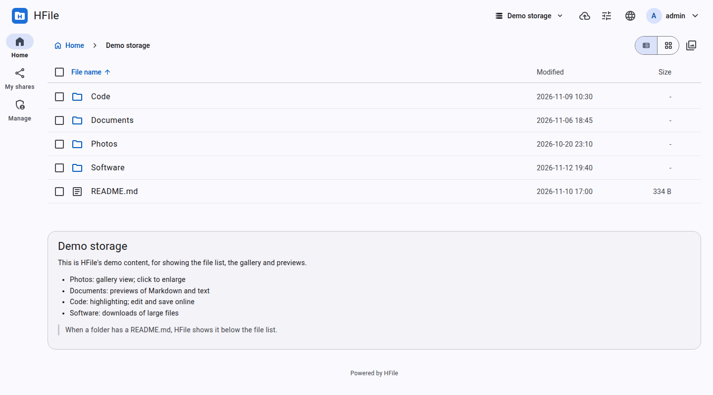
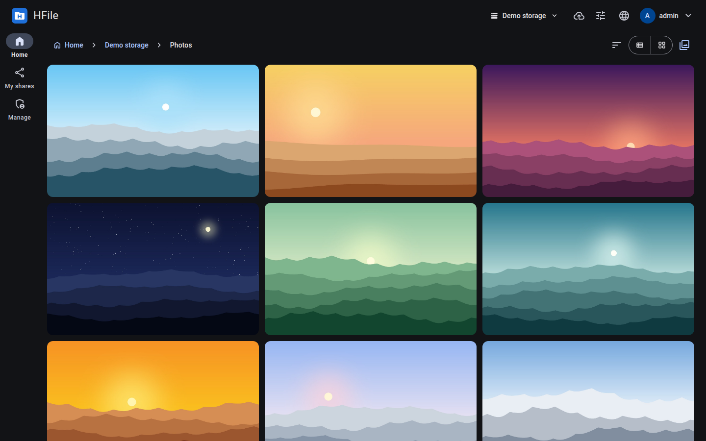
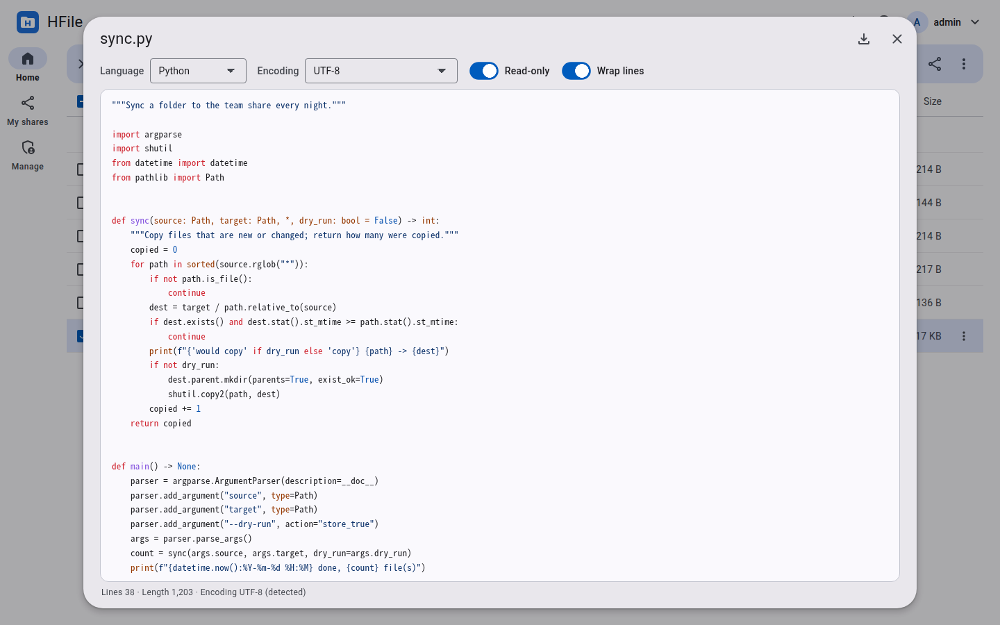
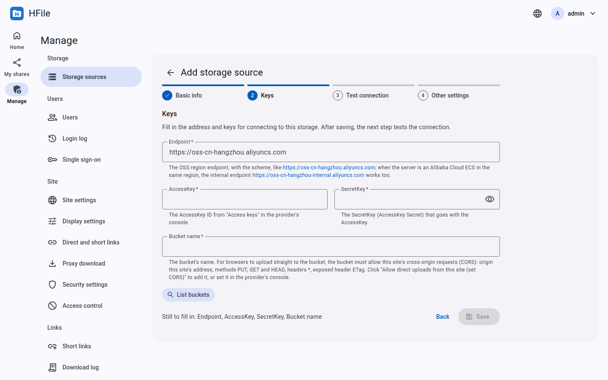
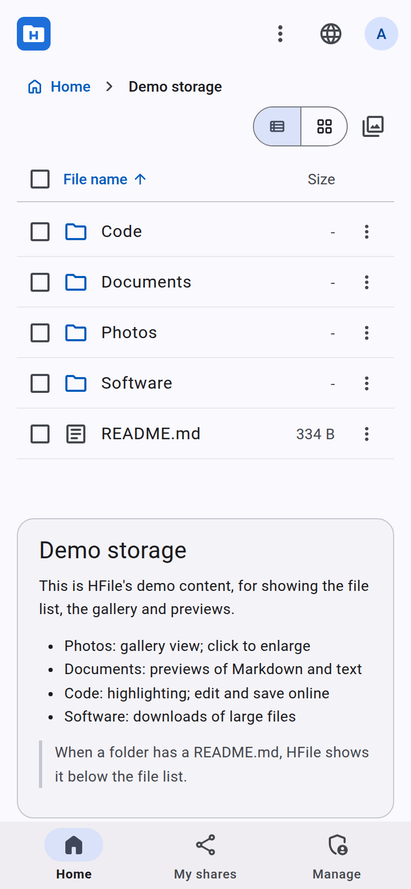

<div align="center">


# HFILE

[](../config/version.py)
[](https://www.python.org/)
[](https://www.djangoproject.com/)
[](../LICENSE)

</div>

[简体中文](../README.md) | English

A self-hosted file listing website: mount local folders, FTP/SFTP, WebDAV, SMB, object storage, cloud drives and self-hosted services on one site, then browse, preview, upload and share.

[Features](#features) · [Screenshots](#screenshots) · [Quick start](#quick-start) · [Deployment](#deployment) · [Configuration](#configuration) · [Documentation](#documentation) · [Contributing](#contributing) · [FAQ](#faq) · [License](#license)

> **Language:** HFile's interface is in Simplified Chinese and English. The detailed documentation in [`docs/`](README.md) is in Chinese only; this README covers installing, deploying and running HFile in English.



## Introduction

HFile brings storage from different places onto one website. In the browser you can browse folders, view images, videos and documents, upload and download, and create direct links and shares. Administrators can give each user their own root folder and permissions on each storage source.

HFile is built with Django:

- **Easy to deploy**: one single-file program, with its own web server and setup wizard; the server doesn't need Python.
- **Interface**: pages follow Material Design 3, with light and dark themes, and work on phones. In Simplified Chinese and English: the browser's language by default, or the one picked in the top bar. No front-end build step and no CDN.
- **Database**: SQLite (the default) or MySQL 8.4+. The database is upgraded automatically at startup, backed up first, and restored automatically if the upgrade fails.

## Features

- **48 storage types**:
  - local folders;
  - FTP (including FTPS), SFTP, WebDAV, SMB (Windows shares, NAS boxes);
  - object storage: S3-compatible storage, MinIO, Alibaba Cloud OSS, Tencent Cloud COS, Huawei Cloud OBS, Qiniu Kodo, DogeCloud, UpYun, Azure Blob Storage, Bunny Storage;
  - cloud drives: OneDrive and SharePoint (both also in their 21Vianet editions for China; OneDrive also with an app's own access to everyone's drive in an organization), Google Drive, 115 Cloud, Alipan (Aliyun Drive), Baidu Netdisk and 123 Cloud Drive (123pan), the last three through their open platforms, Yandex Disk, Dropbox, GitHub repositories, FebBox;
  - self-hosted services: OpenList / AList, Seafile, KodBox, Cloudreve (v3 and v4), Teldrive, Misskey, CloudFlare ImgBed, IPFS, Emby / Jellyfin;
  - read-only share links and release pages: GitHub Releases, CNB Releases, web server directory listings, URL trees, 123 Cloud Drive direct links, OpenList shares, Lenovo NAS shares, OneDrive share links.
  - A four-step wizard adds new storage sources; cloud drives are authorized in the browser or by scanning a QR code.
- **File management**: list, icon and gallery views; new folder, rename, move, copy, delete; context menu, multi-select and keyboard control.
- **Uploads**:
  - drag in files or whole folders;
  - large files go up in chunks, and an upload cut off by the network resumes from the chunk where it stopped;
  - object storage, OneDrive and Dropbox can take uploads straight from the browser, without passing through the site;
  - when a file with the same name exists, you choose whether to overwrite or skip it.
- **Previews**:
  - images; video (including m3u8 and subtitles); audio (with a playlist);
  - text and code, which can be edited online and saved;
  - Markdown, PDF;
  - OnlyOffice (several people can edit at the same time) and kkFileView.
- **Direct links, short links and shares**:
  - direct and short links have download rate limits, Referer-based hotlink protection and download logs;
  - shares can have a password and an expiry date, and what a share shows follows the permissions of the person who shared it.
- **Permissions**: each user has their own root folder and 15 permissions on each storage source. There are also filter rules (hidden, inaccessible, not downloadable), folder passwords and folder readme documents.
- **Accounts and security**: image CAPTCHA, two-factor authentication (TOTP) for superusers, a secret login entrance, single sign-on (GitHub, Gitee, GitLab, OpenID Connect), login logs, IP and user-agent blocklists.
- **Operations**: setup wizard, database backup and restore commands, scheduled cleanup, a diagnostics page; tokens and signatures in the access log are masked automatically.

Every feature is described in detail in [features](features.md) (Chinese).

## Screenshots

<table>
  <tr>
    <td width="50%"><p align="center">Gallery view (dark theme)</p></td>
    <td width="50%"><p align="center">Code preview, also editable online</p></td>
  </tr>
  <tr>
    <td valign="top"><p align="center">Adding a storage source</p></td>
    <td valign="top" align="center"><p align="center">On a phone</p></td>
  </tr>
</table>

The files in the screenshots are demo content; the pictures were generated by a script.

## Tech stack

| Part | Built with |
|---|---|
| Back end | Python 3.12, Django 6.1, Django REST Framework 3.18 |
| Web server | waitress (pure Python, bundled into the program); static files served by WhiteNoise |
| Front end | Django templates and plain JavaScript, following Material Design 3 |
| Previews | hls.js, pdf.js, highlight.js (shipped in the repository, not loaded from a CDN) |
| Database | SQLite or MySQL 8.4+ |
| Packaging | PyInstaller (single-file program) |

## Quick start

### Requirements

- OS: Linux or Windows. The Linux single-file program needs glibc 2.34 or newer (Ubuntu 22.04, Debian 12, Rocky/RHEL 9 or newer); the Windows one is for x86-64 and has only been tried on Windows Server 2025 (see [running on Windows](deploy.md#在-windows-上运行), Chinese).
- To run from source or build the program: conda (for example Miniforge); the environment it creates uses Python 3.12.
- Database: SQLite needs nothing extra; MySQL 8.4 or newer also works (MariaDB and PostgreSQL are not supported).

### Download the program

[Releases](https://github.com/hualuoo/hfile/releases) has the single-file program, one for Linux x86-64, one for arm64 and one for Windows x86-64; no Python needed. There is none for macOS: it hasn't been built or tried there. The commands below fetch the one for this machine, as `uname -m` names it:

```bash
mkdir -p ~/hfile && cd ~/hfile
curl -fLO https://github.com/hualuoo/hfile/releases/latest/download/hfile-linux-$(uname -m)
curl -fLO https://github.com/hualuoo/hfile/releases/latest/download/SHA256SUMS
sha256sum --check --ignore-missing SHA256SUMS   # check the download
mv hfile-linux-$(uname -m) hfile
chmod +x hfile
./hfile                                         # the config file, SQLite database and uploaded files live next to the program
```

On Windows, in PowerShell:

```powershell
mkdir $HOME\hfile; cd $HOME\hfile
curl.exe -fLO https://github.com/hualuoo/hfile/releases/latest/download/hfile-windows-x86_64.exe
curl.exe -fLO https://github.com/hualuoo/hfile/releases/latest/download/SHA256SUMS
(Get-FileHash hfile-windows-x86_64.exe).Hash -eq (Select-String " hfile-windows-x86_64.exe$" SHA256SUMS).Line.Split(" ")[0]   # True: the download checks out
Rename-Item hfile-windows-x86_64.exe hfile.exe
.\hfile.exe                                      # as on Linux, its files live next to the program
```

### Run from source

```bash
git clone https://github.com/hualuoo/hfile.git
cd hfile
conda env create -f environment.yml
conda activate hfile
pip install -r requirements.lock       # indirect dependencies at the tested versions too
python -B hfile.py
```

### Build the single-file program

```bash
conda activate hfile
scripts/build.sh                     # creates dist/hfile from the last commit
mkdir -p ~/hfile && cp dist/hfile ~/hfile/
~/hfile/hfile                        # the config file, SQLite database and uploaded files live next to the program
```

Building also needs binutils (PyInstaller uses its `objdump`; on Debian and Ubuntu, `sudo apt install binutils`). On Windows, run `scripts/build.sh` in Git for Windows' bash; it creates `dist/hfile.exe` and needs no binutils. `dist/hfile-licenses.txt` holds the licenses of the third-party libraries bundled into the program; publish it together with the program.

A program runs on the kind of system it was built on (glibc is only backward compatible). To support older systems, build on the oldest one you want to support; see [building](build.md) (Chinese).

### Setup wizard

On its first run, the program creates the config file `config.toml` next to itself. The file has no secret key yet, so the program starts in setup mode and prints the address of the setup page on the console. The default port is 8080, and the printed address already contains the setup token. Open it in a browser and go through four steps:

1. the setup token;
2. the database: SQLite or MySQL, with a connection test;
3. the site: its name, its public address, the host names allowed to reach it, and how many reverse proxies are in front of it;
4. the first administrator.

When setup is done, the program restarts itself as the normal site. The admin page is at `/manage/`. The Django admin has a random address: the last setup page shows it, and it is also the last item of the admin page's menu. See [installation](install.md) (Chinese).

## Deployment

In production, put HFile behind Caddy or Nginx and let them handle https. Set in `config.toml`:

- `[server]`: `host = "127.0.0.1"`, `proxies = 1`;
- `[site]`: `url` set to the https address.

If you opened the setup page through the proxy, the setup wizard has already filled these in.

Caddy:

```caddy
files.example.com {
    reverse_proxy 127.0.0.1:8080
}
```

Nginx must pass `Host`, `X-Forwarded-For` and `X-Forwarded-Proto`, and its request body limit should match the program's 64 MB:

```nginx
location / {
    proxy_pass http://127.0.0.1:8080;
    proxy_set_header Host $host;
    proxy_set_header X-Forwarded-For $proxy_add_x_forwarded_for;
    proxy_set_header X-Forwarded-Proto $scheme;
    client_max_body_size 64m;
}
```

Run it with systemd, under a dedicated system account (for example `hfile`), not root:

```ini
# /etc/systemd/system/hfile.service
[Unit]
Description=HFile
After=network-online.target mysql.service
Wants=network-online.target

[Service]
User=hfile
ExecStart=/srv/hfile/hfile --config /srv/hfile/config.toml
Restart=on-failure
RestartSec=5
TimeoutStopSec=120

[Install]
WantedBy=multi-user.target
```

Then add a cron job that cleans up expired sessions, uploads, short links and shares:

```cron
17 * * * *  /srv/hfile/hfile cleanup --config /srv/hfile/config.toml
```

Run this cron job and commands such as `backup` and `upgrade` as the account that starts the site, here `hfile` (`crontab -u hfile -e`, `sudo -u hfile /srv/hfile/hfile --config /srv/hfile/config.toml backup`): files and folders they create when run as root belong to root, and the site can't use them.

HSTS, what to watch out for with `/tmp`, exit codes and more are covered in [running](deploy.md) (Chinese).

## Configuration

All of the program's settings are in `config.toml`, each with a comment above it; [`config.example.toml`](../config.example.toml) is what a new one looks like (in Chinese: a new file is in the system's language, English when `LANG` is `en_US.UTF-8`, say). The program looks for the config file in this order:

1. `--config` on the command line;
2. the `HFILE_CONFIG` environment variable;
3. `config.toml` next to the program.

If there is none, it creates one.

| Section | Settings |
|---|---|
| `[server]` | `host`, `port` (default 8080), `threads`, `proxies` (how many reverse proxies are in front), `log_requests` |
| `[database]` | `engine`: `"sqlite"` uses `file`; `"mysql"` uses `host`, `port`, `name`, `user`, `password`, and `tls`, `ca` for encrypted connections |
| `[site]` | `secret_key`, `allowed_hosts`, `url` (the site's public address), `admin_path` (the Django admin's address), `debug` |
| `[paths]` | `uploads` (files the site saves itself, such as its logo and icon), `backups` (database backups) |
| `[upgrade]` | `auto` (upgrade the database automatically at startup) |

The site's own settings, such as its name, logo, previews, direct links, security settings and blocklists, are changed on the admin page and stored in the database. `config.toml` contains the database password and the secret key: don't send it to anyone or put it in a code repository. See [configuration](configuration.md) (Chinese).

## Common commands

When running from source, replace `hfile` with `python -B manage.py`.

The commands speak the system's language: English when the first of `LANGUAGE`, `LC_ALL`, `LC_MESSAGES` and `LANG` that is set starts with `en`, otherwise Chinese. Where none of them is set (some cron jobs and containers), put `LANGUAGE=en` in front of the command.

| Command | What it does |
|---|---|
| `hfile` | Runs the site (same as `hfile serve`) |
| `hfile --version` | Shows the program version |
| `hfile upgrade [--check]` | Upgrades the database; with `--check`, only checks and changes nothing |
| `hfile backup [-o file.sql.gz]` | Backs up the whole database |
| `hfile restore file.sql.gz` | Replaces the whole database with a backup (stop the site first) |
| `hfile cleanup [--dry-run]` | Deletes expired sessions, uploads, short links, shares and OnlyOffice editing sessions, and files left by interrupted backups |
| `hfile resetadmin` | Resets the password when the administrator can't log in |
| `hfile unblock` | Clears the IP and user-agent blocklists when access control has locked you out |
| `hfile createsuperuser` | Creates a superuser |
| `hfile check --deploy` | Django's deployment checks |

## Upgrading

To upgrade, stop the old program, put the new file in its place, and start it again. Before serving any page, the new version checks the database:

- if there are migrations that haven't run yet, it first backs up the whole database to `backups/`, then upgrades;
- if the upgrade fails, it restores the database from that backup and stops, so the old version can keep running;
- once a newer version has upgraded the database, older versions refuse to start.

When running from source, automatic upgrades are off by default: after pulling new code, run `python -B manage.py upgrade` first. See [upgrading](upgrade.md) (Chinese).

## Documentation

The documentation is in Chinese.

| Document | Contents |
|---|---|
| [Features](features.md) | Every feature in detail |
| [Installation](install.md) | Each step of the setup wizard |
| [Configuration](configuration.md) | Every setting in `config.toml` |
| [Running](deploy.md) | Commands, going live, reverse proxies, systemd, scheduled cleanup |
| [Upgrading](upgrade.md) | Database upgrades, backup and restore |
| [Building](build.md) | Building the single-file program with PyInstaller |
| [Development](development.md) | Development environment, the local MySQL container, tests |
| [API](api.md) | Every endpoint under `/api/v1/` |
| [Design](design.md) | How each part is designed, and the code layout |

## Contributing

[Issues](https://github.com/hualuoo/hfile/issues) and pull requests are welcome. See [contributing](CONTRIBUTING.en.md) for how to report bugs, set up a development environment, run the tests and submit changes.

## Project layout

```
hfile/
├── apps/                  Django apps, one folder per feature
│   ├── accounts/          users, login, two-factor authentication, permissions, login logs
│   ├── captchas/          image CAPTCHA
│   ├── core/              shared parts: middleware, JSON parsing, error handling, pagination, encrypted secrets, …
│   ├── crosscheck/        cross-app tests of the access rules
│   ├── files/             file browsing, file operations, signed downloads at /pd/
│   ├── installer/         setup wizard; the serve command (waitress)
│   ├── links/             direct links, short links, download logs
│   ├── office/            OnlyOffice
│   ├── preview/           previews of each kind of file
│   ├── shares/            shares
│   ├── siteconf/          site settings, access control
│   ├── sso/               single sign-on
│   ├── storages/          storage sources and access policies; drivers/ holds the drivers of the 48 storage types and an example for new ones
│   ├── upgrades/          upgrades, backup and restore
│   ├── uploads/           uploads, saving online edits
│   └── web/               page shell, admin page, error pages, styles and scripts
├── config/                settings, reading and writing config.toml, command-line entry point, URL routes
├── docs/                  documentation (Chinese)
├── scripts/               build.sh (packaging), dev-db.sh (local MySQL container), …
├── docker/                init script for the local MySQL container
├── hfile.py               entry point of the single-file program
├── manage.py              Django's command line
└── config.example.toml    what a new config file looks like
```

More detail in [design](design.md#代码结构) (Chinese).

## FAQ

**I forgot the administrator password, lost the phone with my two-factor codes, or forgot the secret login entrance. What now?**

Run `hfile resetadmin` on the server and type the new password twice in the terminal. It turns off two-factor authentication for that account and shows the login address at the end.

**Access control has locked out my own IP. What now?**

Run `hfile unblock` on the server. It clears the IP and user-agent blocklists; the running site picks this up within 30 seconds.

**Behind a reverse proxy I can't log in, or every IP address shown is the proxy's. What now?**

Check `[site] url` and `[server] proxies` in `config.toml`. The diagnostics page (诊断信息 under 系统 on the admin page) points out what is set up wrong.

**After changing `secret_key`, every storage source reports errors. What now?**

The secrets of storage sources are stored encrypted with `secret_key`, so they can't be read after it changes. Enter them again on each storage source's edit page: authorize cloud drives again, and scan the QR code again for 115. Everyone also has to log in again.

**The setup page asks for a setup token I don't know.**

The token is printed in the program's output, and also saved in `install-token.txt` next to the config file, readable only by the system account that runs the program.

**How do I make a complete backup?**

`hfile backup` backs up only the database. Also copy the uploads folder (`[paths] uploads`) and `config.toml`: the secrets stored encrypted in the backup can only be read with the same `secret_key`.

## License

HFile is released under the [Apache License 2.0](../LICENSE).

The bundled hls.js, pdf.js (Apache-2.0) and highlight.js (BSD-3-Clause) keep their own licenses. Third-party copyright and license notices are in [NOTICE](../NOTICE).

## Acknowledgements

- [Django](https://www.djangoproject.com/), [Django REST Framework](https://www.django-rest-framework.org/), [waitress](https://github.com/Pylons/waitress), [WhiteNoise](https://github.com/evansd/whitenoise), [httpx](https://www.python-httpx.org/), [paramiko](https://www.paramiko.org/), [PyInstaller](https://pyinstaller.org/) and other open-source projects.
- [hls.js](https://github.com/video-dev/hls.js), [pdf.js](https://github.com/mozilla/pdf.js), [highlight.js](https://github.com/highlightjs/highlight.js).
- [Material Design 3](https://m3.material.io/).
